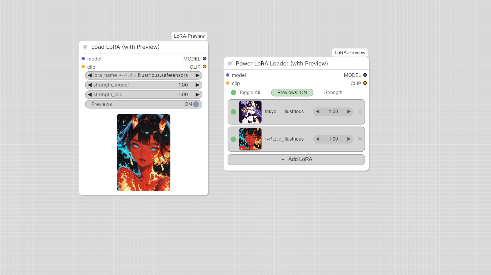

# ComfyUI LoRA Preview

نودهای لودر LoRA برای ComfyUI که **عکس پریویوی هر لورا را نشان می‌دهند**.

> English: [README.md](README.md)



## نودها

### Load LoRA (with Preview)
لودر معمولی لورا (`model`، `clip`، `lora_name`، `strength_model`، `strength_clip`) که عکس لورای انتخاب‌شده را
زیر ویجت‌ها نشان می‌دهد. دکمه‌ی **Previews ON/OFF** عکس را مخفی می‌کند.

### Power LoRA Loader (with Preview)
نود چندلورا به سبک Power Lora Loader، با هر تعداد لورا:

- هر لورا یک ردیف: دایره‌ی روشن/خاموش، عکس کوچک، اسم، strength (`◀ 1.00 ▶`) و حذف (`✕`)
- دکمه‌ی **＋ Add LoRA** لیست لوراها را باز می‌کند
- موس را روی ردیف ببری، عکس بزرگ کنار نود نمایش داده می‌شود
- بالای نود **Toggle All** و **Previews: ON/OFF** وجود دارد
- روی عدد کلیک کنی می‌توانی مقدار را تایپ کنی و با فلش‌ها ۰٫۰۵ تغییر می‌کند
- هر ردیف یک strength دارد که هم روی مدل و هم روی clip اعمال می‌شود

### پریویو داخل لیست انتخاب لورا
هر منوی کشویی که اسم لورا داشته باشد (حتی LoraLoader خود ComfyUI)، با رفتن موس روی هر آیتم،
عکس آن لورا را در یک کادر ثابت کنار منو نشان می‌دهد.

## ورکفلو نمونه

فایل `example_workflows/LoRA-Preview-Example.json` هر دو نود را دارد. در ComfyUI از بخش **Templates** (زیر همین بسته‌ی نود) بازش کن یا فایل را روی صفحه بکش و رها کن. اسم لوراهای داخلش نمونه است؛ بعد از لود، لوراهای خودت را انتخاب کن.

## عکس پریویو

عکس باید کنار فایل لورا و هم‌اسم آن باشد. برای `my_lora.safetensors` به این ترتیب جستجو می‌شود:

`my_lora.preview.png`، `my_lora.preview.jpg`، `my_lora.preview.jpeg`، `my_lora.preview.webp`،
`my_lora.png`، `my_lora.jpg`، `my_lora.jpeg`، `my_lora.webp`

لوراهای داخل زیرپوشه‌ها هم کار می‌کنند. برای پسوند بیشتر، `PREVIEW_SUFFIXES` در `__init__.py` را ویرایش کن.

## نصب

**با ComfyUI-Manager** (بعد از انتشار در Registry): عبارت `LoRA Preview` را جستجو و نصب کن.

**دستی:**
```bash
cd ComfyUI/custom_nodes
git clone https://github.com/shhostweb-beep/ComfyUI-LoRA-Preview
```
ComfyUI را ریستارت کن و مرورگر را با `Ctrl+F5` رفرش کن. نیازی به نصب پکیج پایتون اضافه نیست.

## نکته‌ها

- ردیف‌های با strength صفر یا خاموش اعمال نمی‌شوند.
- لیست لوراهای نود Power داخل ورکفلو به شکل یک رشته‌ی JSON (`loras_json`) ذخیره می‌شود.

## لایسنس

MIT
